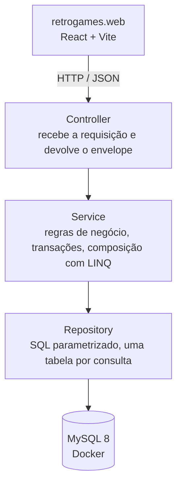

# RetroGames

Marketplace de jogos retrô: um catálogo público de cartuchos e discos clássicos e uma área de administração para cadastrar plataformas e jogos.


Projeto individual da disciplina **DCE701 – Programação Web** (UNIFAL-MG).

---

## Sumário

- [Visão geral](#visão-geral)
- [Estado do projeto](#estado-do-projeto)
- [Arquitetura](#arquitetura)
- [Como rodar hoje](#como-rodar-hoje)
- [Banco de dados](#banco-de-dados)
- [Uso de IA no desenvolvimento](#uso-de-ia-no-desenvolvimento)

---

## Visão geral

O RetroGames é uma loja on-line de jogos de consoles antigos. O sistema terá dois públicos:

| Público | O que faz |
| --- | --- |
| **Visitante / cliente** | Navega pelo catálogo público de jogos ativos, filtra por plataforma e gênero e busca pelo nome. |
| **Administrador** | Mantém o cadastro de plataformas (consoles) e de jogos: nome, descrição, preço, estoque, condição (novo, usado, recondicionado) e gêneros. |

Os perfis de acesso (`Administrador` e `Cliente`) e as condições de conservação já existem no banco como dados fixos.

---

## Estado do projeto

O desenvolvimento segue os roteiros da disciplina. Este repositório está em andamento: até agora existem o ambiente, o banco de dados, as classes de modelo e a camada de acesso a dados.

| Roteiro | Conteúdo | Situação |
| --- | --- | --- |
| 1 | Ambiente (Docker + MySQL), solução .NET com seis projetos, front `retrogames.web` criado com Vite, scripts SQL (`database/`) e classes de modelo | Entregue |
| 2 | Camada Repository: base com conexão e parâmetros, repositórios de plataforma, jogo, jogo × gênero, gênero e condição, e o `RepositorySet` | Entregue |
| 3 a 8 | Próximas etapas da disciplina | Planejado |

**Ainda não existe** no código: controllers da API, Services e regras de negócio, validações, autenticação, telas do front (o `retrogames.web` ainda é o modelo inicial do Vite) e testes unitários (o projeto de testes está criado, mas vazio).

Prazos já conhecidos:

| Sprint | Entrega até |
| --- | --- |
| 12 | 08/11 |
| 13 | 15/11 |
| 14 | 22/11 |

---

## Arquitetura

A API segue uma arquitetura em camadas. Cada camada conversa só com a de baixo:



| Camada | Responsabilidade | Não faz |
| --- | --- | --- |
| Controller | Recebe a requisição, chama o Service e devolve `{ responseCode, data, errorMessage }` com o status HTTP | Regra de negócio, SQL |
| Validator | Valida formato (obrigatório, tamanho, faixa) | Consultar o banco |
| Service | Regras de negócio, transações e composição de dados de várias tabelas com LINQ | Conhecer HTTP ou SQL |
| Repository | SQL parametrizado e mapeamento coluna → propriedade | Decidir regras, abrir transações |

Hoje, só a camada **Repository** (e os modelos que ela usa) está implementada.

### Projetos da solução

| Projeto | Papel |
| --- | --- |
| `RetroGames.Model` | Uma classe por tabela (`Plataforma`, `Jogo`, `Genero`, `JogoGenero`, `CondicaoJogo`, `Perfil`, `Usuario`) e constantes das chaves fixas. |
| `RetroGames.Repository` | Acesso ao MySQL com ADO.NET (MySqlConnector): `RepositoryBase`, um repositório por tabela e o `RepositorySet`. |
| `RetroGames.Services` | Camada de regras de negócio (criada, ainda sem código). |
| `RetroGames.WebApi` | API ASP.NET Core com controllers (por enquanto só o `Program.cs` inicial). |
| `RetroGames.WebApi.ApiModels` | Modelos de entrada e saída da API, no padrão `{Ação}{Entidade}{Request\|Response}ApiModel` (ainda vazio). |
| `RetroGames.WebApi.UnitTests` | Testes unitários com xUnit (projeto criado, sem testes). |
| `retrogames.web` | Front-end em React 19 + Vite, em JavaScript. Bootstrap 5, React Router 7 e Axios estão planejados e ainda não foram instalados. |

---

## Como rodar hoje

Pré-requisitos: Docker com Compose, .NET SDK 10 e Node.js com npm. Os comandos abaixo são para um terminal bash (Linux, macOS, WSL ou Git Bash), a partir da raiz do repositório.

### 1. Clonar e configurar o `.env`

```bash
git clone https://github.com/gabrielhsp-sys/RetroGames.git
cd RetroGames
cp .env.example .env
```

Abra o `.env` e troque as duas ocorrências de `SUA_SENHA` pela senha que você quer usar no MySQL local. O `.env` está no `.gitignore` e nunca deve ser versionado.

### 2. Subir o MySQL

```bash
docker compose up -d
```

O container se chama `retrogames_mysql` e escuta na porta `3306`. Para acompanhar até ficar `healthy`:

```bash
docker compose ps
```

### 3. Criar o banco

> **Atenção:** `01-schema.sql` apaga e recria o banco `retrogames`. Rodá-lo de novo descarta todos os dados locais.

Os scripts rodam dentro do container, que já conhece a senha pela variável `MYSQL_ROOT_PASSWORD`:

```bash
docker exec -i retrogames_mysql sh -c 'mysql --default-character-set=utf8mb4 -uroot -p"$MYSQL_ROOT_PASSWORD"' < database/01-schema.sql
docker exec -i retrogames_mysql sh -c 'mysql --default-character-set=utf8mb4 -uroot -p"$MYSQL_ROOT_PASSWORD"' < database/02-dados.sql
```

Opcionalmente, rode as consultas e os testes de integridade. O script de testes precisa de `--force`, porque os testes 1 a 4 devem falhar de propósito:

```bash
docker exec -i retrogames_mysql sh -c 'mysql --default-character-set=utf8mb4 -uroot -p"$MYSQL_ROOT_PASSWORD"' < database/03-consultas.sql
docker exec -i retrogames_mysql sh -c 'mysql --default-character-set=utf8mb4 -uroot -p"$MYSQL_ROOT_PASSWORD" --force' < database/04-testes-integridade.sql
```

O cliente avisa `Using a password on the command line interface can be insecure`. O aviso é esperado nesse uso local.

### 4. Compilar a solução .NET

```bash
dotnet build
```

### 5. Rodar o front-end

```bash
cd retrogames.web
npm install
npm run dev
```

O Vite abre em <http://localhost:5173/>. Por enquanto a página é o modelo inicial do Vite.

---

## Banco de dados

MySQL 8 com `utf8mb4`. O banco guarda só a estrutura (PK, FK, tipos, `NOT NULL` e `UNIQUE`). Não há trigger, function, `CHECK` nem `ON DELETE CASCADE`: as regras de negócio ficam no Service.

### Tabelas

| Tabela | Conteúdo |
| --- | --- |
| `tb_plataforma` | Consoles: nome (único), fabricante e ano de lançamento. |
| `tb_jogo` | Jogos à venda: nome, descrição (opcional), ano, preço, estoque, ativo, data de cadastro, plataforma e condição. |
| `tb_genero` | Gêneros (nome único). |
| `tb_jogo_genero` | Associação jogo × gênero (chave primária composta). |
| `tb_condicao_jogo` | Domínio fixo: Novo, Usado, Recondicionado. |
| `tb_perfil` | Domínio fixo: Administrador, Cliente. |
| `tb_usuario` | Usuários: nome, e-mail (único), hash da senha, ativo, data de cadastro e perfil. |

Os nomes seguem a convenção `tb_` (tabela), `co_seq_` (chave gerada), `co_` (código), `no_` (nome), `ds_` (descrição), `nu_` (número), `vl_` (valor), `qt_` (quantidade), `dt_` (data) e `st_` (situação).

### Scripts em `database/`

| Script | O que faz |
| --- | --- |
| `01-schema.sql` | Apaga e recria o banco `retrogames` com as sete tabelas. |
| `02-dados.sql` | Dados de exemplo: 3 condições, 2 perfis, 7 plataformas (uma sem jogos), 8 gêneros, 20 jogos e 29 associações jogo × gênero. Nenhum usuário: o administrador será criado pela API. |
| `03-consultas.sql` | Cinco consultas de estudo: catálogo de jogos ativos, gêneros de um jogo, jogos de um gênero, quantidade de jogos por plataforma e busca paginada por nome. |
| `04-testes-integridade.sql` | Cinco testes das restrições: FK inexistente, nome de plataforma duplicado, exclusão de plataforma com jogos e nome de jogo nulo (devem falhar), e preço zero (aceito, porque essa regra é do Service). No fim, apaga os dados de teste e confere os totais. |

As consultas de `03-consultas.sql` usam `JOIN` para estudar o modelo. Na API, cada consulta do Repository lê uma única tabela, e a composição é feita no Service, com LINQ.

---

## Uso de IA no desenvolvimento

O uso de IA é parte da disciplina. Este repositório usa um assistente de código guiado pelo [`AGENTS.md`](AGENTS.md), que define a stack permitida, as responsabilidades de cada camada, as convenções de nomes e as regras de segurança.

Os prompts são escritos pelo estudante. O código sugerido pelo assistente é lido e conferido antes do commit (compilação da solução e execução dos scripts SQL), e o estudante responde pelo que entra no repositório.
