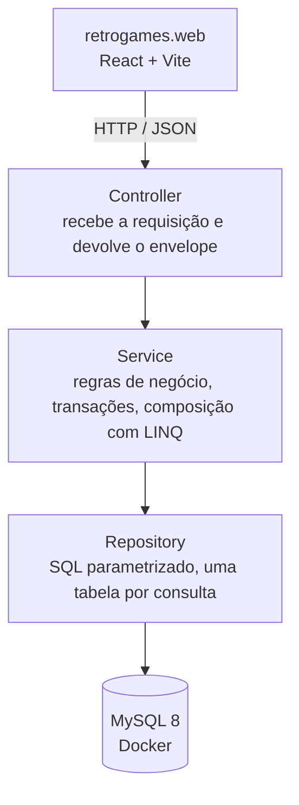

# RetroGames

Loja on-line de jogos retrô: um catálogo público de cartuchos e discos clássicos, compra pelo cliente e uma área de administração para cadastrar plataformas, jogos e gêneros e acompanhar os pedidos.


Projeto individual da disciplina **DCE701 – Programação Web** (UNIFAL-MG).

---

## Sumário

- [Visão geral](#visão-geral)
- [Estado do projeto](#estado-do-projeto)
- [Documentação](#documentação)
- [Arquitetura](#arquitetura)
- [Como rodar](#como-rodar)
- [Banco de dados](#banco-de-dados)
- [Uso de IA no desenvolvimento](#uso-de-ia-no-desenvolvimento)

---

## Visão geral

O RetroGames é uma loja on-line de jogos de consoles antigos, com três públicos:

| Público | O que faz |
| --- | --- |
| **Visitante** | Navega pelo catálogo de jogos ativos, busca pelo nome, filtra por plataforma e gênero e cria a própria conta de cliente. |
| **Cliente** | Monta o carrinho, finaliza a compra e acompanha os próprios pedidos e o detalhe de cada um. |
| **Administrador** | Mantém plataformas, jogos (com exclusão lógica) e gêneros, lista todos os pedidos com filtro por situação e muda a situação de cada pedido. |

---

## Estado do projeto

Situação em 27/11/2026 (commit `71c0c6e` no `main`). Entrega do Módulo de Compras: 29/11/2026.

| Etapa | Conteúdo | Situação |
| --- | --- | --- |
| Roteiro 1 | Ambiente (Docker + MySQL), solução .NET com seis projetos, front `retrogames.web`, scripts SQL e classes de modelo | Entregue |
| Roteiro 2 | Camada Repository: um repositório por tabela e o `RepositorySet` | Entregue |
| Roteiro 3 | Camada Service: regras de negócio, `BusinessErrors`, `BusinessRuleException` e transação na gravação de jogo com gêneros | Entregue |
| Roteiro 4 | API de leitura: envelope, `ResponseCodes`, `GlobalExceptionHandler`, Swagger e rotas GET | Entregue |
| Roteiro 5 | API de gravação: ApiModels de entrada, validators FluentValidation, POST, PUT e DELETE | Entregue |
| Roteiro 6 | Autenticação por cookie, senha em hash, administrador inicial e API segura por padrão | Entregue |
| Roteiro 7 | Front-end público: acesso à API, rotas, catálogo e detalhe do jogo | Entregue |
| Roteiro 8 | Front-end com login, sessão e telas de administração de plataformas e jogos | Entregue |
| Roteiro 9 | Testes unitários dos Services com xUnit e Moq | Entregue |
| Módulo de Compras | Versão completa do desafio, histórias C01 a C08: cadastro de cliente, menu do cliente, carrinho, finalizar compra, meus pedidos, detalhe do pedido, gestão de pedidos e manutenção de gêneros | Entregue, com três pontos de C07 em aberto (abaixo) |

Conferência de 27/11/2026: `dotnet build` sem erros nem avisos, `dotnet test` com 69 testes e 0 falhas e `npm run build` do `retrogames.web` sem erro.

**Pendente em C07 (decisão do professor).** O desafio não define estes pontos, e o código não escolheu nenhuma alternativa:

- Regra de transição entre situações: hoje qualquer troca é aceita.
- Devolução de estoque ao cancelar: hoje o estoque não volta.
- Paginação da lista de pedidos do administrador: hoje não há paginação.

---

## Documentação

| Arquivo | Conteúdo |
| --- | --- |
| [`docs/USER_STORIES.md`](docs/USER_STORIES.md) | Histórias C01 a C08 com critérios de aceite, regras, códigos de erro e a rastreabilidade (Espec. 7.1): história, endpoints, classes, testes e commits. |
| [`docs/API.md`](docs/API.md) | Todos os endpoints, com acesso, status de sucesso e erros, e os catálogos `ResponseCodes` e `BusinessErrors`. |
| [`docs/MER.md`](docs/MER.md) | Tabelas, colunas e relacionamentos, incluindo as tabelas de pedido. |
| [`docs/SPRINT-COMPRAS.md`](docs/SPRINT-COMPRAS.md) | Sprint do Módulo de Compras: objetivo, datas, tarefas por história e revisão. |
| [`AGENTS.md`](AGENTS.md) | Regras do projeto para o assistente de IA: stack, camadas, nomes, banco e segurança. |

---

## Arquitetura

A API segue uma arquitetura em camadas. Cada camada conversa só com a de baixo:



| Camada | Responsabilidade | Não faz |
| --- | --- | --- |
| Controller | Recebe a requisição, chama o Service e devolve `{ responseCode, data, errorMessage }` com o status HTTP | Regra de negócio, SQL |
| Validator | Valida formato (obrigatório, tamanho, faixa) | Consultar o banco |
| Service | Regras de negócio, transações e composição de dados de várias tabelas com LINQ | Conhecer HTTP ou SQL |
| Repository | SQL parametrizado e mapeamento coluna → propriedade | Decidir regras, abrir transações |

### Projetos da solução

| Projeto | Papel |
| --- | --- |
| `RetroGames.Model` | Uma classe por tabela (`Plataforma`, `Jogo`, `Genero`, `JogoGenero`, `CondicaoJogo`, `Perfil`, `Usuario`, `SituacaoPedido`, `Pedido`, `ItemPedido`), constantes das chaves fixas e filtros. |
| `RetroGames.Repository` | Acesso ao MySQL com ADO.NET (MySqlConnector): `RepositoryBase`, um repositório por tabela e o `RepositorySet`. |
| `RetroGames.Services` | Regras de negócio, ServiceModels, o catálogo `BusinessErrors` e a `BusinessRuleException`. |
| `RetroGames.WebApi` | API ASP.NET Core com controllers, validators, mappers, autenticação por cookie e o `GlobalExceptionHandler`. |
| `RetroGames.WebApi.ApiModels` | Modelos de entrada e saída da API, no padrão `{Ação}{Entidade}{Request\|Response}ApiModel`, o envelope e o `ResponseCodes`. |
| `RetroGames.WebApi.UnitTests` | Testes unitários dos Services e de dois validators de pedido, com xUnit e Moq. |
| `retrogames.web` | Front-end em React 19 + Vite, em JavaScript, com Bootstrap 5, React Router 7 e Axios. |

---

## Como rodar

Pré-requisitos: Docker com Compose, .NET SDK 10 e Node.js com npm (a especificação usa o Node.js 22 LTS). Os comandos abaixo são para um terminal bash (Linux, macOS, WSL ou Git Bash), a partir da raiz do repositório.

### 1. Clonar e configurar o `.env`

```bash
git clone https://github.com/gabrielhsp-sys/RetroGames.git
cd RetroGames
cp .env.example .env
```

Abra o `.env` e troque as três ocorrências de `SUA_SENHA`:

| Variável | O que é |
| --- | --- |
| `MYSQL_ROOT_PASSWORD` | Senha do `root` do MySQL, usada pelo `docker compose` ao criar o container. |
| `ConnectionStrings__Default` | Cadeia de conexão da API. A senha aqui deve ser a mesma do `MYSQL_ROOT_PASSWORD`. |
| `AdminInicial__Email` e `AdminInicial__Senha` | Login do administrador que a API cria na primeira inicialização, se ainda não existir nenhum. |

O `.env` está no `.gitignore` e nunca deve ser versionado. A API o lê com o pacote DotNetEnv, procurando nas pastas acima até a raiz do repositório.

### 2. Subir o MySQL

```bash
docker compose up -d
```

O container se chama `retrogames_mysql` e escuta na porta `3306`. Para acompanhar até ficar `healthy`:

```bash
docker compose ps
```

### 3. Criar o banco

> **Atenção:** `01-schema.sql` apaga e recria o banco `retrogames`. Rodá-lo de novo descarta todos os dados locais, inclusive usuários e pedidos; depois dele, rode `02-dados.sql` e `05-compras.sql` outra vez.

Os scripts rodam dentro do container, que já conhece a senha pela variável `MYSQL_ROOT_PASSWORD`. Os três obrigatórios, nesta ordem:

```bash
docker exec -i retrogames_mysql sh -c 'mysql --default-character-set=utf8mb4 -uroot -p"$MYSQL_ROOT_PASSWORD"' < database/01-schema.sql
docker exec -i retrogames_mysql sh -c 'mysql --default-character-set=utf8mb4 -uroot -p"$MYSQL_ROOT_PASSWORD"' < database/02-dados.sql
docker exec -i retrogames_mysql sh -c 'mysql --default-character-set=utf8mb4 -uroot -p"$MYSQL_ROOT_PASSWORD"' < database/05-compras.sql
```

Opcionalmente, rode as consultas de estudo (`03`, `06`, `07` e `08`, que não deixam alterações no banco) e os testes de integridade. O script de testes precisa de `--force`, porque os testes 1 a 4 devem falhar de propósito:

```bash
docker exec -i retrogames_mysql sh -c 'mysql --default-character-set=utf8mb4 -uroot -p"$MYSQL_ROOT_PASSWORD"' < database/03-consultas.sql
docker exec -i retrogames_mysql sh -c 'mysql --default-character-set=utf8mb4 -uroot -p"$MYSQL_ROOT_PASSWORD" --force' < database/04-testes-integridade.sql
```

O cliente avisa `Using a password on the command line interface can be insecure`. O aviso é esperado nesse uso local.

### 4. Subir a API

```bash
dotnet build
cd RetroGames.WebApi
dotnet run
```

A API responde em <http://localhost:5080>. Em desenvolvimento, o Swagger UI fica em <http://localhost:5080/swagger>. Na inicialização, a API cria o administrador do `.env` se ainda não houver nenhum.

### 5. Subir o front-end

Em outro terminal, a partir da raiz do repositório:

```bash
cd retrogames.web
npm install
npm run dev
```

O Vite abre em <http://localhost:5173/> e repassa para a API tudo o que começa com `/api` (proxy no `vite.config.js`). Para o navegador, front-end e API têm a mesma origem, e o cookie de sessão vai junto.

Para entrar como administrador, use o e-mail e a senha do `AdminInicial` no `.env`. Para comprar como cliente, crie uma conta pelo link **Criar conta** da tela de Login (`/cadastro`).

### 6. Rodar os testes e o build do front

Na raiz do repositório:

```bash
dotnet test
```

Os testes não usam banco: os repositórios são simulados com Moq.

No `retrogames.web`:

```bash
npm run build
```

---

## Banco de dados

MySQL 8 com `utf8mb4`. O banco guarda só a estrutura (PK, FK, tipos, `NOT NULL` e `UNIQUE`). Não há trigger, function, `CHECK` nem `ON DELETE CASCADE`: as regras de negócio ficam no Service. Colunas, chaves e relacionamentos estão em [`docs/MER.md`](docs/MER.md).

### Tabelas

| Tabela | Conteúdo |
| --- | --- |
| `tb_plataforma` | Consoles: nome (único), fabricante e ano de lançamento. |
| `tb_jogo` | Jogos à venda: nome, descrição (opcional), ano, preço, estoque, ativo, data de cadastro, plataforma e condição. |
| `tb_genero` | Gêneros (nome único). |
| `tb_jogo_genero` | Associação jogo × gênero (chave primária composta). |
| `tb_condicao_jogo` | Domínio fixo: Novo, Usado, Recondicionado. |
| `tb_perfil` | Domínio fixo: Administrador, Cliente. |
| `tb_usuario` | Usuários: nome, e-mail (único), hash da senha, ativo, data de cadastro e perfil. |
| `tb_situacao_pedido` | Domínio fixo: Pendente, Pago, Enviado, Cancelado. |
| `tb_pedido` | Pedidos: data (UTC), total, cliente e situação. |
| `tb_item_pedido` | Itens do pedido: quantidade, preço pago, pedido e jogo; um jogo aparece uma só vez em cada pedido. |

Os nomes seguem a convenção `tb_` (tabela), `co_seq_` (chave gerada), `co_` (código), `no_` (nome), `ds_` (descrição), `nu_` (número), `vl_` (valor), `qt_` (quantidade), `dt_` (data) e `st_` (situação).

### Scripts em `database/`

| Script | O que faz |
| --- | --- |
| `01-schema.sql` | Apaga e recria o banco `retrogames` com as sete tabelas do catálogo. |
| `02-dados.sql` | Dados de exemplo: 3 condições, 2 perfis, 7 plataformas (uma sem jogos), 8 gêneros, 20 jogos e 29 associações jogo × gênero. Nenhum usuário: o administrador é criado pela API. |
| `03-consultas.sql` | Cinco consultas de estudo: catálogo de jogos ativos, gêneros de um jogo, jogos de um gênero, quantidade de jogos por plataforma e busca paginada por nome. |
| `04-testes-integridade.sql` | Cinco testes das restrições: FK inexistente, nome de plataforma duplicado, exclusão de plataforma com jogos e nome de jogo nulo (devem falhar), e preço zero (aceito, porque essa regra é do Service). No fim, apaga os dados de teste e confere os totais. |
| `05-compras.sql` | Módulo de Compras: cria `tb_situacao_pedido` (com as quatro situações), `tb_pedido` e `tb_item_pedido`. |
| `06-consultas-compras.sql` | Consultas dos repositórios de pedido (C04 e C05); as gravações são desfeitas com `ROLLBACK`. |
| `07-consultas-gestao-pedidos.sql` | Consultas do detalhe (C06) e da gestão de pedidos (C07); a troca de situação é desfeita com `ROLLBACK`. |
| `08-consultas-generos.sql` | Consultas da manutenção de gêneros (C08); as gravações são desfeitas com `ROLLBACK`. |

As consultas de `03-consultas.sql` usam `JOIN` para estudar o modelo. Na API, cada consulta do Repository lê uma única tabela, e a composição é feita no Service, com LINQ.

---

## Uso de IA no desenvolvimento

O uso de IA é parte da disciplina. Este repositório usa um assistente de código guiado pelo [`AGENTS.md`](AGENTS.md), que define a stack permitida, as responsabilidades de cada camada, as convenções de nomes e as regras de segurança.

Os prompts são escritos pelo estudante. O código sugerido pelo assistente é lido e conferido antes do commit (compilação da solução e execução dos scripts SQL), e o estudante responde pelo que entra no repositório.
