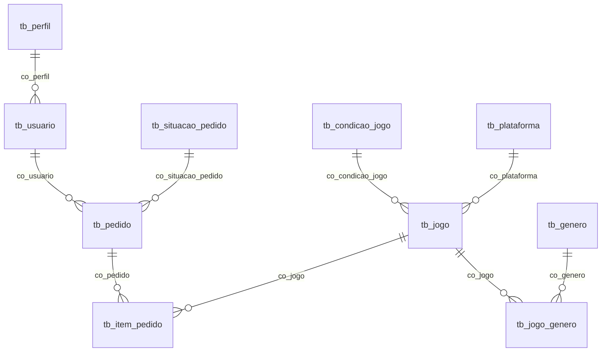

# Modelo de dados (MER)

Tabelas, colunas e relacionamentos do banco `retrogames`, tirados dos scripts em `database/`. Complementa a seção 4 da especificação **RetroGames — Arquitetura e Stack**, que descreve só as tabelas do Módulo de Catálogo e Administração. As três tabelas do Módulo de Compras seguem a seção "Banco de dados" do desafio.

Convenção de nomes (Espec. 4.1): `tb_` tabela, `co_seq_` chave gerada (`AUTO_INCREMENT`), `co_` chave fixa de domínio ou chave estrangeira, `no_`/`ds_` nome/descrição, `nu_`/`qt_`/`vl_` número/quantidade/valor, `dt_` data e hora em UTC, `st_` indicador booleano.

O banco guarda só a estrutura (Espec. 4.3): PK, FK com o comportamento padrão do MySQL, tipos, `NOT NULL` e `UNIQUE`. Não há trigger, function, `CHECK`, `ON DELETE CASCADE` nem `ON DELETE SET NULL`. As regras de negócio ficam nos Services (ver [USER_STORIES.md](USER_STORIES.md)).

## Diagrama

## Tabelas

Mesmas colunas da tabela 4.2 da especificação (Tabela, Tipo, Descrição, Relacionamentos).

| Tabela | Tipo | Descrição | Relacionamentos |
| --- | --- | --- | --- |
| `tb_condicao_jogo` | Domínio | Condição de conservação do jogo | 1:N com `tb_jogo` |
| `tb_perfil` | Domínio | Perfis de acesso (Administrador, Cliente) | 1:N com `tb_usuario` |
| `tb_plataforma` | Cadastro | Console ou plataforma do jogo | 1:N com `tb_jogo` |
| `tb_genero` | Cadastro (mantido pelo administrador desde C08; na Espec. 4.2, "somente leitura") | Gênero do jogo | N:N com `tb_jogo` |
| `tb_jogo` | Principal | Jogo à venda: nome, descrição, ano, preço, estoque e situação | N:1 com plataforma e condição; 1:N com `tb_item_pedido` |
| `tb_jogo_genero` | Associativa | Associação entre jogo e gênero (chave primária composta) | N:1 com `tb_jogo` e `tb_genero` |
| `tb_usuario` | Cadastro | Usuário do sistema, com e-mail único e hash de senha | N:1 com `tb_perfil`; 1:N com `tb_pedido` |
| `tb_situacao_pedido` | Domínio (Compras) | Situação do pedido (Pendente, Pago, Enviado, Cancelado) | 1:N com `tb_pedido` |
| `tb_pedido` | Principal (Compras) | Compra finalizada: data em UTC, total, cliente e situação | N:1 com `tb_usuario` e `tb_situacao_pedido`; 1:N com `tb_item_pedido` |
| `tb_item_pedido` | Associativa com dados (Compras) | Jogo de um pedido, com quantidade e preço pago | N:1 com `tb_pedido` e `tb_jogo` |

Script e classe de modelo (`RetroGames.Model/Model`, uma por tabela): as sete primeiras ficam em `01-schema.sql`, e as três de Compras em `05-compras.sql`. A classe tem o nome da tabela sem `tb_`, em PascalCase (`tb_item_pedido` → `ItemPedido`).

## Dicionário de dados: tabelas do Módulo de Compras

Definidas em `database/05-compras.sql`.

### `tb_situacao_pedido`

| Coluna | Tipo | Nulo | Restrição | Propriedade |
| --- | --- | --- | --- | --- |
| `co_situacao_pedido` | `INT` | não | PK (`pk_situacao_pedido`), chave fixa, sem `AUTO_INCREMENT` | `SituacaoPedido.Id` |
| `ds_situacao_pedido` | `VARCHAR(50)` | não | `UNIQUE` (`uk_situacao_pedido_ds_situacao_pedido`) | `SituacaoPedido.Descricao` |

Dados fixos, inseridos pelo próprio script e espelhados em `RetroGames.Model/Constantes/SituacaoPedidoIds.cs`:

| `co_situacao_pedido` | `ds_situacao_pedido` | Constante |
| --- | --- | --- |
| 1 | Pendente | `SituacaoPedidoIds.Pendente` |
| 2 | Pago | `SituacaoPedidoIds.Pago` |
| 3 | Enviado | `SituacaoPedidoIds.Enviado` |
| 4 | Cancelado | `SituacaoPedidoIds.Cancelado` |

### `tb_pedido`

| Coluna | Tipo | Nulo | Restrição | Propriedade |
| --- | --- | --- | --- | --- |
| `co_seq_pedido` | `INT AUTO_INCREMENT` | não | PK (`pk_pedido`) | `Pedido.Id` |
| `dt_pedido` | `DATETIME` | não | gravada em UTC pelo `PedidoService` | `Pedido.Data` |
| `vl_total` | `DECIMAL(10,2)` | não | calculado no `PedidoService` com os preços do banco | `Pedido.Total` |
| `co_usuario` | `INT` | não | FK `fk_pedido_usuario` → `tb_usuario.co_seq_usuario` | `Pedido.IdUsuario` |
| `co_situacao_pedido` | `INT` | não | FK `fk_pedido_situacao_pedido` → `tb_situacao_pedido.co_situacao_pedido` | `Pedido.IdSituacaoPedido` |

### `tb_item_pedido`

| Coluna | Tipo | Nulo | Restrição | Propriedade |
| --- | --- | --- | --- | --- |
| `co_seq_item_pedido` | `INT AUTO_INCREMENT` | não | PK (`pk_item_pedido`) | `ItemPedido.Id` |
| `qt_item` | `INT` | não | faixa 1 a 10 conferida no validator, não no banco | `ItemPedido.Quantidade` |
| `vl_unitario` | `DECIMAL(10,2)` | não | preço do jogo no momento da compra | `ItemPedido.ValorUnitario` |
| `co_pedido` | `INT` | não | FK `fk_item_pedido_pedido` → `tb_pedido.co_seq_pedido` | `ItemPedido.IdPedido` |
| `co_jogo` | `INT` | não | FK `fk_item_pedido_jogo` → `tb_jogo.co_seq_jogo` | `ItemPedido.IdJogo` |

`UNIQUE (co_pedido, co_jogo)` (`uk_item_pedido_co_pedido_co_jogo`): um jogo aparece uma só vez em cada pedido.

## Dicionário de dados: tabelas do Catálogo e Administração

Definidas em `database/01-schema.sql`, conforme a Espec. 4.2. Só `ds_jogo` aceita `NULL`.

| Tabela | Colunas | Restrições |
| --- | --- | --- |
| `tb_condicao_jogo` | `co_condicao_jogo INT`, `ds_condicao_jogo VARCHAR(50)` | PK; `UNIQUE (ds_condicao_jogo)` |
| `tb_perfil` | `co_perfil INT`, `ds_perfil VARCHAR(50)` | PK; `UNIQUE (ds_perfil)` |
| `tb_plataforma` | `co_seq_plataforma INT AUTO_INCREMENT`, `no_plataforma VARCHAR(80)`, `no_fabricante VARCHAR(80)`, `nu_ano_lancamento INT` | PK; `UNIQUE (no_plataforma)` |
| `tb_genero` | `co_seq_genero INT AUTO_INCREMENT`, `no_genero VARCHAR(50)` | PK; `UNIQUE (no_genero)` |
| `tb_jogo` | `co_seq_jogo INT AUTO_INCREMENT`, `no_jogo VARCHAR(150)`, `ds_jogo VARCHAR(1000) NULL`, `nu_ano_lancamento INT`, `vl_preco DECIMAL(10,2)`, `qt_estoque INT`, `st_ativo BOOLEAN DEFAULT TRUE`, `dt_cadastro DATETIME`, `co_plataforma INT`, `co_condicao_jogo INT` | PK; FK `fk_jogo_plataforma`, `fk_jogo_condicao_jogo` |
| `tb_jogo_genero` | `co_jogo INT`, `co_genero INT` | PK composta `(co_jogo, co_genero)`; FK `fk_jogo_genero_jogo`, `fk_jogo_genero_genero` |
| `tb_usuario` | `co_seq_usuario INT AUTO_INCREMENT`, `no_usuario VARCHAR(100)`, `ds_email VARCHAR(256)`, `ds_senha_hash VARCHAR(500)`, `st_ativo BOOLEAN DEFAULT TRUE`, `dt_cadastro DATETIME`, `co_perfil INT` | PK; `UNIQUE (ds_email)`; FK `fk_usuario_perfil` |

O cadastro de cliente (C01) não muda `tb_usuario`: o e-mail já é único desde `01-schema.sql` (`uk_usuario_ds_email`), e o perfil Cliente (`co_perfil = 2`) vem de `02-dados.sql`.

## Scripts em `database/`

| Script | Conteúdo | Grava dados? |
| --- | --- | --- |
| `01-schema.sql` | Apaga e recria o banco `retrogames` com as sete tabelas do catálogo. | Recria o banco: apaga tudo |
| `02-dados.sql` | Dados de exemplo: condições, perfis, plataformas, gêneros, jogos e associações. Nenhum usuário: o administrador inicial é criado pela API a partir do `.env`. | Sim |
| `03-consultas.sql` | Consultas de estudo do catálogo (usam `JOIN`; a API não usa). | Não |
| `04-testes-integridade.sql` | Testes das restrições do banco; alguns falham de propósito (rodar com `--force`). Apaga os dados de teste no fim. | Temporário |
| `05-compras.sql` | Cria `tb_situacao_pedido` (com as quatro situações), `tb_pedido` e `tb_item_pedido`. Não apaga nada; depois de rodar `01-schema.sql` de novo, rode este outra vez. | Sim |
| `06-consultas-compras.sql` | Consultas dos repositórios de pedido (C04 e C05). As gravações rodam numa transação desfeita com `ROLLBACK`. | Não |
| `07-consultas-gestao-pedidos.sql` | Consultas do detalhe (C06) e da gestão de pedidos (C07). A troca de situação roda numa transação desfeita com `ROLLBACK`. | Não |
| `08-consultas-generos.sql` | Consultas da manutenção de gêneros (C08). As gravações rodam numa transação desfeita com `ROLLBACK`. | Não |

Na API, cada consulta de Repository lê uma única tabela, sem `JOIN` nem subconsulta em outra tabela; a composição é feita no Service, com LINQ (Espec. 3.1).
